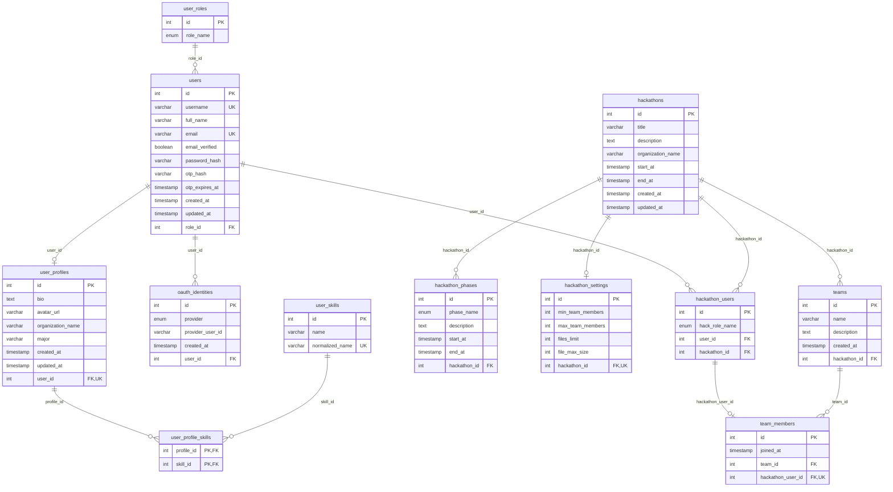

# HackSpace database schema

The PostgreSQL schema is managed by TypeORM migrations in
`backend/src/database/migrations/`. The diagram below describes the intended
**freshly migrated schema** after the naming-standardisation changes.

- TypeScript entity properties use `camelCase`; physical PostgreSQL tables and
  columns use `snake_case` (for example, `User.fullName` maps to `users.full_name`).
- `user_skills` is the **shared skills catalogue**, not a direct user-to-skill table;
  the many-to-many junction is `user_profile_skills`.
- The `hackathon_settings.hackathon_id` foreign key stays on the settings table;
  the owning side of that one-to-one relationship has **not** moved.

## Entity relationship diagram



## Constraints and important rules

| Table | Relevant constraint | Purpose |
| --- | --- | --- |
| `users` | Unique `username` and `email` | Prevent duplicate accounts |
| `user_profiles` | Unique `user_id` | At most one profile per user |
| `oauth_identities` | Unique (`provider`, `provider_user_id`) | One external identity per provider and provider user |
| `hackathons` | `start_at < end_at` | Enforce valid overall dates |
| `hackathon_phases` | `start_at < end_at` | Enforce valid phase dates |
| `hackathon_settings` | Unique `hackathon_id`; non-negative file limits; valid min/max team size | One settings row per hackathon, with valid limits |
| `hackathon_users` | Unique (`user_id`, `hackathon_id`) | One registration per user per hackathon |
| `teams` | Unique (`hackathon_id`, `name`) | No duplicate team names within a hackathon |
| `team_members` | Unique `hackathon_user_id` | A registration may belong to at most one team |
| `user_skills` | Unique `normalized_name` | Case/whitespace-normalised catalogue uniqueness |
| `user_profile_skills` | Composite primary key (`profile_id`, `skill_id`) | No duplicate profile-skill association |

Some constraints above are enforced by the database; additional domain rules
(such as only participants joining teams, team capacity, administrator overrides
and active registration windows) are enforced in NestJS services.

## Naming and migration verification

The development team agreed to reset local databases when the physical FK and
skills-column names are standardised. The affected legacy physical columns are:

| Table | Previous | Target |
| --- | --- | --- |
| `users` | `roleId` | `role_id` |
| `user_profiles` | `userId` | `user_id` |
| `oauth_identities` | `userId` | `user_id` |
| `user_skills` | `normalizedName` | `normalized_name` |

For a new or deliberately reset **local development** database, apply the
current migrations and seed data in that order. Do not modify applied migration
history on shared or production databases.

```bash
make migration
make seed
```

After migration, verify TypeORM's metadata against PostgreSQL without applying
unreviewed schema changes:

```bash
# Within the backend container, using the configured local database:
npm run typeorm -- schema:log -d src/database/data-source.ts
```

The actual migrations remain the authoritative source of physical constraints,
column types and delete behaviour.
