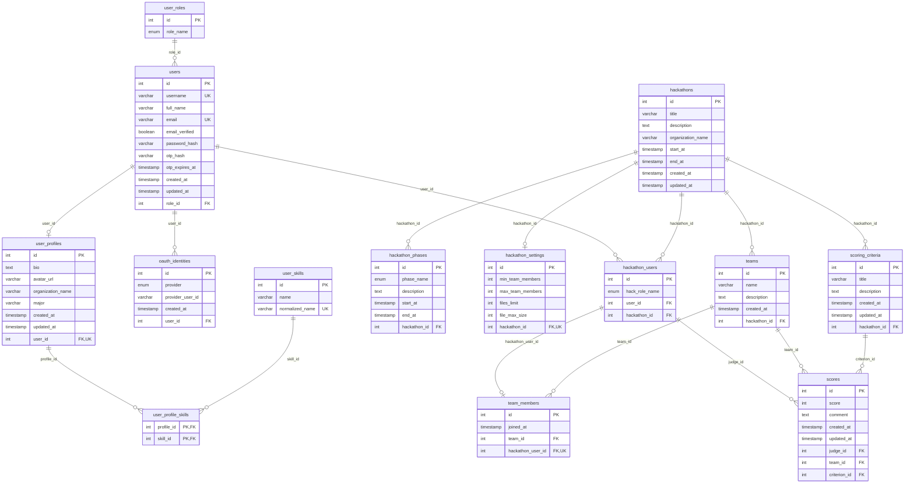

# HackSpace database schema

The PostgreSQL schema is managed by TypeORM migrations in
`backend/src/database/migrations/`. The diagram below describes the intended
**freshly migrated schema** after the naming-standardisation changes.

- TypeScript entity properties use `camelCase`; physical PostgreSQL tables and
  columns use `snake_case` (for example, `User.fullName` maps to `users.full_name`).
- `user_skills` is the **shared skills catalogue**, not a direct user-to-skill table;
  the many-to-many junction is `user_profile_skills`.
- The `hackathon_settings.hackathon_id` foreign key stays on the settings table;
  the owning side of that one-to-one relationship has **not** moved.

## Entity relationship diagram



## Constraints and important rules

| Table                 | Relevant constraint                                                | Purpose                                               |
| --------------------- | ------------------------------------------------------------------ | ----------------------------------------------------- |
| `users`               | Unique `username` and `email`                                      | Prevent duplicate accounts                            |
| `user_profiles`       | Unique `user_id`                                                   | At most one profile per user                          |
| `oauth_identities`    | Unique (`provider`, `provider_user_id`)                            | One external identity per provider and provider user  |
| `hackathons`          | `start_at < end_at`                                                | Enforce valid overall dates                           |
| `hackathon_phases`    | `start_at < end_at`                                                | Enforce valid phase dates                             |
| `hackathon_settings`  | Unique `hackathon_id`; file limits >= 1; valid min/max team size   | One settings row per hackathon, with valid limits     |
| `hackathon_users`     | Unique (`user_id`, `hackathon_id`)                                 | One registration per user per hackathon               |
| `teams`               | Unique (`hackathon_id`, `name`)                                    | No duplicate team names within a hackathon            |
| `team_members`        | Unique `hackathon_user_id`                                         | A registration may belong to at most one team         |
| `scoring_criteria`    | Unique (`hackathon_id`, `title`)                                   | Prevent duplicate criterion titles within a hackathon |
| `scores`              | Unique (`judge_id`, `team_id`, `criterion_id`); `0 <= score <= 10` | One integer score per judge/team/criterion            |
| `user_skills`         | Unique `normalized_name`                                           | Case/whitespace-normalised catalogue uniqueness       |
| `user_profile_skills` | Composite primary key (`profile_id`, `skill_id`)                   | No duplicate profile-skill association                |

Hackathon settings defaults are `min_team_members = 1`, `max_team_members = 5`,
`files_limit = 1`, and `file_max_size = 10485760` (10 MiB, stored in **bytes**).
Both file limits must be positive; existing files are retained when settings
limits are reduced, while subsequent uploads and replacements use the new limits.
The minimum team size is enforced when submitting a project, not when creating a team.
A maximum reduction is rejected when an existing team already exceeds it.

Some constraints above are enforced by the database; additional domain rules
(such as only participants joining teams, team capacity, administrator overrides
and active registration windows) are enforced in NestJS services.

## Jury and scoring

Migration `1795310793374-CreateJuryScoring.ts` creates `scoring_criteria` and `scores`. Judges reuse `hackathon_users` with `hack_role_name = JURY`; no separate judge table is introduced. `scores.judge_id` references the membership ID, not `users.id`.

- `scoring_criteria.title` is `varchar(100)` and non-null; `description` is nullable text. `scores.score` is a non-null integer; `comment` is nullable text. Both tables have non-null creation and update timestamps defaulting to `now()`.
- All four new foreign keys are non-null and use `ON DELETE CASCADE`: deleting a hackathon removes its criteria, and deleting a judge membership, team or criterion removes associated scores.
- The service enforces the judge role, same-hackathon relationships, finalised submission eligibility, phase restrictions and comment length; these are not additional database check constraints.
- Score writes use a transaction and upsert on the unique judge/team/criterion key, with shared hackathon and team locks and consistent criterion ordering. Rankings and evaluation completion are computed on demand, not stored in a separate table.

- Criteria can be created, edited or deleted before the scheduled `IN_PROGRESS` start, including pre-launch. Judge memberships can be assigned or removed before the scheduled `EVALUATION` start. Missing required phases reject management operations. These service-level restrictions apply to organisers and platform administrators alike.
- Judge removal deletes only the specified `JURY` membership in the hackathon; the platform account and other hackathon memberships remain intact. Criterion deletion is scoped to the specified hackathon. Existing foreign-key cascades remove dependent scores; normal management closes before scoring begins.
- Criterion updates preserve omitted fields, allow a null description, and enforce trimmed non-empty titles and the existing per-hackathon unique constraint. No new tables, columns or migrations are required for these management operations.
- Rankings include finalised teams only. Average all criterion scores for each complete judge evaluation, then average complete evaluations equally. Round the team average to two decimal places before sorting descending, with team ID ascending as the tie-breaker. Equal rounded averages share competition ranks (`1, 1, 3`). Teams without complete evaluations have null average and rank and sort last by ID.

## Naming and migration verification

The development team agreed to reset local databases when the physical FK and
skills-column names are standardised. The affected legacy physical columns are:

| Table              | Previous         | Target            |
| ------------------ | ---------------- | ----------------- |
| `users`            | `roleId`         | `role_id`         |
| `user_profiles`    | `userId`         | `user_id`         |
| `oauth_identities` | `userId`         | `user_id`         |
| `user_skills`      | `normalizedName` | `normalized_name` |

For a new or deliberately reset **local development** database, apply the
current migrations and seed data in that order. Do not modify applied migration
history on shared or production databases.

```bash
make migration
make seed
```

After migration, verify TypeORM's metadata against PostgreSQL without applying
unreviewed schema changes:

```bash
# Within the backend container, using the configured local database:
npm run typeorm -- schema:log -d src/database/data-source.ts
```

The actual migrations remain the authoritative source of physical constraints,
column types and delete behaviour.
