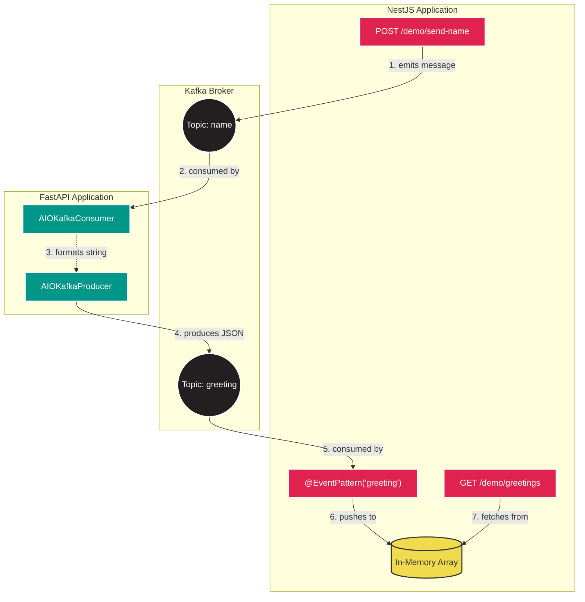

# Kafka Event-Driven Architecture Documentation

This document outlines the local Kafka infrastructure utilized in the Hackspace project to facilitate asynchronous, event-driven communication between the NestJS (`backend`) and FastAPI (`ai_service`) microservices.

## Architecture Overview

The project uses a single-node Apache Kafka cluster running in **KRaft mode** (without Zookeeper).



## Infrastructure Components

The Kafka infrastructure is defined in `docker-compose.yml` and consists of three specialized containers:

### 1. `broker`
The core Kafka server operating in KRaft mode, acting as both a broker and its own controller.
*   **Image:** `apache/kafka:latest`
*   **Ports:** `9092` (Client traffic)
*   **Configuration Highlights:**
    *   `KAFKA_OFFSETS_TOPIC_REPLICATION_FACTOR: 1`: Critical for single-node development. Without this, the `__consumer_offsets` topic fails to build, permanently breaking consumer groups.
    *   `KAFKA_PROCESS_ROLES: broker,controller`: Enables KRaft mode.
*   **Healthcheck:** Pings the broker via `kafka-topics.sh` every 10 seconds to ensure the process is ready to accept connections.

### 2. `init-kafka`
An ephemeral bootstrap container responsible for automatically creating required topics before any microservice connects.
*   **Execution:** Mounts and runs `./infrastructure/scripts/kafka-init.sh`.
*   **Dependency:** Waits for the `broker` container to pass its healthcheck (`condition: service_healthy`) before executing.

### 3. `kafka-ui`
A web-based graphical interface for inspecting the cluster.
*   **Access:** Available at `http://localhost:8080`.
*   **Capabilities:** View live message streams, inspect consumer group offsets, and manually publish test messages.

## Service Integration Strategy

To prevent race conditions where consumers attempt to connect to topics that do not exist yet, both the `backend` and `ai_service` enforce a strict boot sequence in Docker Compose:

```yaml
depends_on:
  init-kafka:
    condition: service_completed_successfully
```

This ensures that the application servers remain suspended until `init-kafka` successfully finishes building the topics and gracefully exits with a status code of `0`.

## Developer Guidelines & Troubleshooting

When developing or modifying the Kafka integration between NestJS and FastAPI, observe the following constraints:

*   **Group Coordinator Failures:** If you see `GroupCoordinatorNotAvailableError` infinitely looping in FastAPI or NestJS, the Kafka volume is likely corrupted by a previous misconfiguration. Fix it by destroying the container and its volume entirely to force a clean cluster format:
    `docker compose down -v && docker compose up -d`
*   **Payload Serialization:** Python's `aiokafka` producer must serialize dictionaries into JSON bytes (e.g., `json.dumps({"value": "data"}).encode('utf-8')`). If raw strings are sent, the NestJS `@EventPattern()` will fail to parse the payload as an object, resulting in `undefined` variables.
*   **NestJS Historical Offsets:** By default, NestJS ignores messages published before it joined the consumer group. Ensure `fromBeginning: true` is set in the `subscribe` options of the NestJS Kafka client configuration to prevent dropped messages during container restarts.
*   **Microservice Registration:** NestJS requires `await app.startAllMicroservices()` in `main.ts`. Omitting this will silently disable all `@EventPattern` decorators without throwing an error.